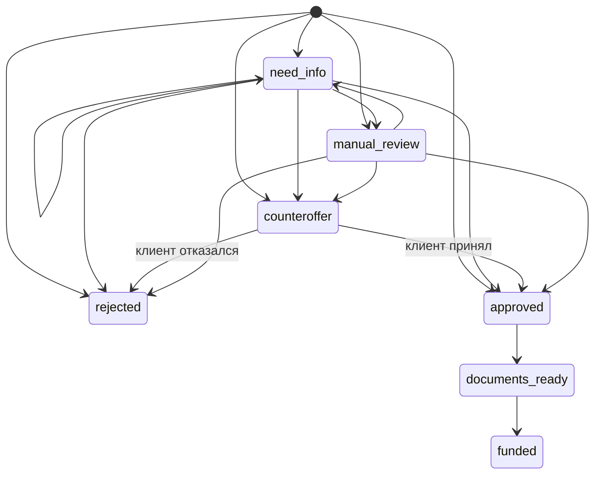

# Состояния заявки

Отдельных статусов `draft`, `submitted`, `enriched` и `scored` в интерфейсе нет: проверки и оценка происходят в одном шаге отправки. В базе остаются только состояния, которые видит человек.

| Откуда | Куда | Кто | Условие |
|---|---|---|---|
| новая заявка | need_info | система | не заполнены цель, сумма, срок, тип, возраст, сотрудники или отрасль |
| новая заявка | rejected | система | ЕГРЮЛ вернул ликвидацию, модель не вызывается |
| новая заявка | rejected | система | вероятность списания не ниже PD_REVIEW |
| новая заявка | counteroffer | система | лимит продукта нарушен, а вероятность ниже PD_REVIEW |
| новая заявка | manual_review | система | вероятность между порогами или в бюро есть просрочка |
| новая заявка | approved | система | вероятность ниже PD_APPROVE и лимиты соблюдены |
| need_info | любой исход выше | клиент | дополнил данные, конвейер запускается снова |
| counteroffer | approved | клиент | принял предложенные сумму, срок и продукт |
| counteroffer | rejected | клиент | отказался от предложения |
| manual_review | approved, counteroffer, need_info, rejected | сотрудник | комментарий обязателен |
| approved | documents_ready | клиент | нажал «Подготовить документы» |
| documents_ready | funded | клиент | подтвердил смоделированную выдачу |
