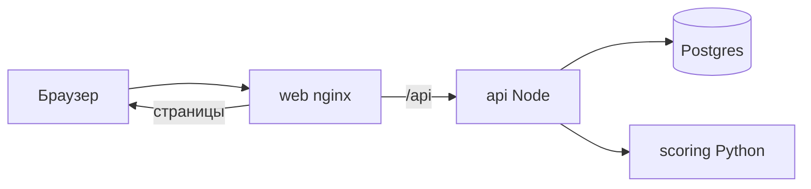

# Архитектура

`web` публикует один порт, по умолчанию 8080. `scoring` и Postgres доступны только в сети Compose.

Модель читает девять полей заявки и возвращает `pd_chargeoff` и `risk_score`. Правила продукта, лимиты, ликвидация и просрочка живут в API. Одинаковая вероятность на оборотном кредите и на кредите на оборудование может дать разное решение, потому что лимиты разные.
